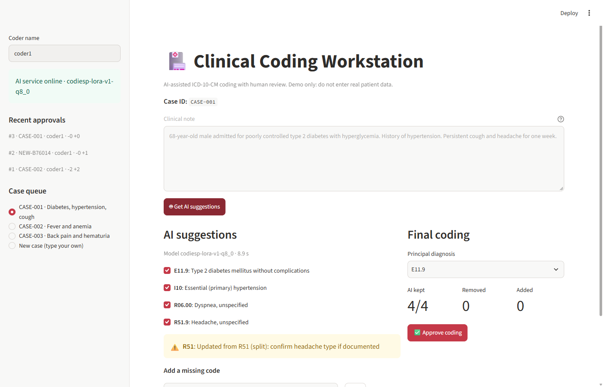
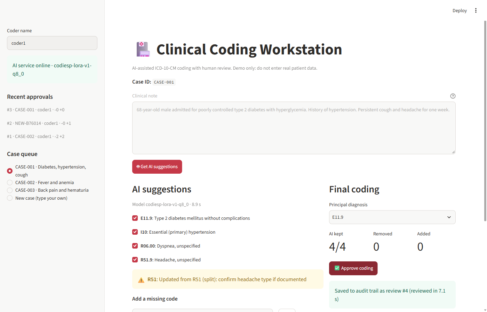
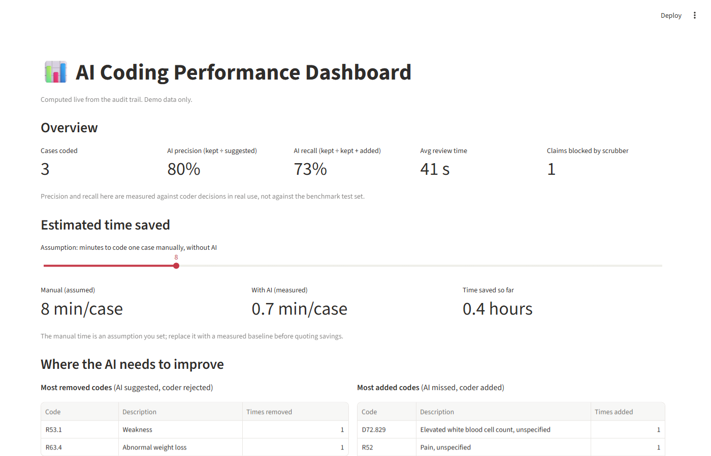

# Clinic-code: Clinical Coding Copilot (demo)

AI-assisted ICD-10-CM coding with human review. A fine-tuned Qwen2.5-3B model (served by Ollama)
suggests codes, rule checks validate them, a coder approves, and every decision goes to an audit trail.

**Demo only: do not enter real patient data. The API has no authentication.**

## Parts
- `app/api.py`: FastAPI service (`/suggest`, `/reviews`, claim XML export)
- `app/engine.py`, `app/rules.py`: model call and ICD-10-CM validity/Excludes1 checks
- `app/audit.py`: SQLite audit trail (`data/audit.db`, created on first approval, not in git)
- `workstation.py`: Streamlit coder workstation
- `dashboard.py`: Streamlit performance dashboard

## Screenshots (real model output, demo case CASE-001)

**1. AI suggestions with rule checks**: accepted codes, a flagged code, and the final-coding panel.


**2. Coder approval saved to the audit trail**


**3. Performance dashboard**


## Setup
```
python -m venv .venv
.venv\Scripts\activate
pip install -r requirements.txt
```
Install [Ollama](https://ollama.com), then place the model file at `models/icd-coder-q8_0.gguf`
(model files are not in this repo because of their size) and run:
```
ollama create icd-coder -f Modelfile
```

## Run
```
.\start-demo.ps1
```
or start each part yourself:
```
python -m uvicorn app.api:app --port 8001
python -m streamlit run workstation.py
python -m streamlit run dashboard.py --server.port 8502
```
Workstation: http://localhost:8501 · Dashboard: http://localhost:8502 · API docs: http://localhost:8001/docs

## Notes
- The LoRA adapter (`adapter/adapter_model.safetensors`, 120 MB) is excluded from git (GitHub's 100 MB limit).
- Claim XML uses a simplified demo format, not validated against any payer schema.
